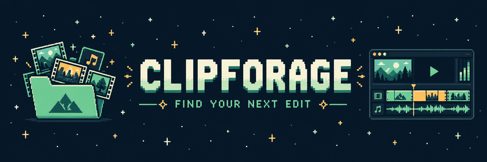

# ClipForage

[](https://github.com/Ry0x7/ClipForage-source/actions/workflows/ci.yml) [](LICENSE) [](https://www.python.org/downloads/)

**Find footage, memes and sounds for your next edit — in one place.**

ClipForage is a free, open-source app for video editors. Search YouTube and free stock
libraries, preview results, see the license, and download clips or audio to your computer.
It runs locally and opens in your browser.

**No coding needed to use the app.** The first setup uses a few copy-and-paste commands;
after that, search and download with buttons. You can start without API keys or AI.
Some extra sources need a free API key, and optional AI assist may cost money.

[Get started](#install) · [Your first download](#your-first-download) ·
[Troubleshooting](#troubleshooting) · [Sources](#providers) · [Contribute](#contributing)


> **Alpha:** ready to try, still being improved. Searches and downloads depend on the source.
> Editor drag-and-drop, transparent-video import, the live Pexels API and the Anthropic AI
> backend are not yet verified. See [known issues](docs/KNOWN_ISSUES.md) for current limits.

## What can I find?

| For your edit | Try searching for | What you can do |
|---|---|---|
| Memes and green screens | `crying cat`, `green screen explosion` | Preview and download clips; remove a green background into a transparent WebM. |
| B-roll (supporting footage) | `rain city`, `ocean sunset` | Find footage and filter by orientation or duration. |
| Music and sound effects | `lofi`, `whoosh`, `applause` | Search audio and download tracks or sound effects. |
| Images, fonts and overlays | `paper texture`, `handwriting` | Explore images, fonts and animated graphics. Some sources need keys. |
| A spoken line | `never gonna give you up` | Use Phrase mode to look for words in captions and download that moment. |

Every result shows the license information reported by its source, including whether credit
is required or commercial use is allowed. Downloads include a matching `.json` text file with
the source, license and attribution details to keep with your media.

## Install

You need an internet connection and a Windows, macOS or Linux computer. ClipForage currently
installs from this GitHub repository; these steps use **uv** (an installer that also manages
Python) and **Git** (which fetches the app). You do not need to install Python separately.

Paste one command at a time into the command window and press **Enter**. Wait for each command
to finish before continuing. Messages scrolling past are normal during installation.

### 1. Install the setup tools once

<details open>
<summary><strong>Windows (PowerShell)</strong></summary>

Open the Start menu, type **PowerShell**, and open it. Paste these commands one at a time:

```powershell
winget install --id astral-sh.uv -e
winget install --id Git.Git -e
```

Accept the installer prompts if asked. Once both finish, **close PowerShell and open it again**
so it can find the new tools. Already have uv or Git? Skip that tool's install command.

If `winget` is unavailable, use the [uv installation guide](https://docs.astral.sh/uv/getting-started/installation/)
and [Git installer](https://git-scm.com/downloads), then reopen PowerShell.

</details>

<details>
<summary><strong>macOS</strong></summary>

Open **Terminal** (search for it with Spotlight). Install uv:

```sh
curl -LsSf https://astral.sh/uv/install.sh | sh
```

Install Git using the [Git installation guide](https://git-scm.com/downloads/mac).
On macOS, ClipForage also needs you to install ffmpeg separately. If you already use
[Homebrew](https://brew.sh/), run:

```sh
brew install ffmpeg
```

Otherwise, follow the Homebrew setup instructions first. Then **close Terminal and reopen it**.

</details>

<details>
<summary><strong>Linux</strong></summary>

Open your terminal and install uv:

```sh
curl -LsSf https://astral.sh/uv/install.sh | sh
```

Install Git with your distribution's package manager; for example, on Ubuntu or Debian:

```sh
sudo apt install git
```

Then **close the terminal and reopen it**.

</details>

### 2. Install ClipForage

In your reopened PowerShell or terminal window, run:

```sh
uv tool install --python 3.12 git+https://github.com/Ry0x7/ClipForage-source
uv tool update-shell
```

**Close and reopen the command window once more** so it can find the `clipforage` command.
For more about the installer, see the [uv tool guide](https://docs.astral.sh/uv/guides/tools/).

### 3. Finish setup and open the app

```sh
clipforage setup
clipforage serve
```

The setup command downloads the media tools ffmpeg and Deno on supported Windows/Linux systems;
on macOS it downloads Deno and reminds you to install ffmpeg separately.
The second command opens the app at **[http://127.0.0.1:8765](http://127.0.0.1:8765)**.
This address is the app running on your own computer.

**Keep the command window open while you use ClipForage.** If the browser does not open
automatically, click the address above or paste it into your browser.

### Open it again next time

Open PowerShell or Terminal and run:

```sh
clipforage serve
```

You only need to install and set up once. To stop the app, return to the command window and
press **Ctrl+C**. Closing just the browser tab leaves the app running.

## Your first download

1. In the **Search** tab, leave Mode set to **Assets**.
2. Type something like `crying cat`, `rain b-roll` or `whoosh`. Choose a **Kind** and, for videos,
   a **Style** such as **Meme**, **Green screen** or **Cinematic**, then click **Search**.
3. Click a thumbnail to preview a result. Read its rights badge and use **Source** to check
   the original page. **Filters → Cleared for use only** hides results marked copyrighted,
   non-commercial or with unknown rights; credit or other license conditions may still apply.
4. Click **Download** to save the asset. On YouTube video results, **MP3** saves just the audio.
5. Open **Downloads** or **History**, then use **Show in folder** to find the saved file.
   Import it into your video editor as you would any other media file.

New installs save to **Downloads → clipforage** in your home folder. Change this in
**Settings → Library folder**. Keep the matching `.json` file for the source and credit details.

**Start with the built-in sources.** YouTube, Openverse, Wikimedia Commons and Internet Archive
work without API keys. For Pexels, Pixabay, Freesound and Google Fonts, add your own key in
**Settings**. An API key is a code a source gives you to let ClipForage access its service.
See the [source list](#providers) for all options.

**The app's MIT license covers its code; each downloaded asset has its own terms.** Check
the source page before publishing your edit.

## Troubleshooting

| What you see | What to try |
|---|---|
| `uv` or `git` is not recognized / command not found | Close and reopen the command window after installing the setup tools. If it still fails, check that tool's installation guide in step 1. |
| `clipforage` is not recognized / command not found | Run `uv tool update-shell`, then close and reopen the command window. If installation reported an error, resolve it and repeat step 2. |
| The browser page will not load | Run `clipforage serve` and leave its window open. Open `http://127.0.0.1:8765` manually. |
| Address already in use / port 8765 is busy | ClipForage may already be running; try the browser address first. Otherwise run `clipforage serve --port 8766` and open `http://127.0.0.1:8766`. |
| Downloads report missing ffmpeg or Deno | Run `clipforage setup` again, then `clipforage doctor` to see which tools are found. On macOS, install ffmpeg separately as shown above. |
| A source has no results or asks for a key | Try a different query or source. Add a key in **Settings** for sources that require one. A source can also be temporarily unavailable. |

Still stuck? Check [known issues](docs/KNOWN_ISSUES.md) or
[open an issue](https://github.com/Ry0x7/ClipForage-source/issues). Include your operating system,
what you tried, and the error message. Remove API keys or other private details before posting.

## What works today, and what doesn't

For editors, especially short-form clippers (checked in a live run on 2026-10-06):

- **Works:** meme and green-screen search (best with `--style meme` or `green_screen`), sound
  effects, clip-range mp4 and mp3 downloads with a license sidecar, and `keyout` to a
  transparent WebM.
- **Not yet:** cleared (copyright-safe) music is thin: `--cleared-only` asks Openverse and
  Internet Archive for cleared licenses (mostly CC samples, Jamendo and netlabel tracks), and the
  big cleared music libraries are link-outs only; `--shorts` cannot tell vertical YouTube videos
  apart, so YouTube results come first unsorted; dragging onto an editor timeline is unverified; the chroma preview does not work on YouTube results. Details:
  [docs/KNOWN_ISSUES.md](docs/KNOWN_ISSUES.md).

## What it will not do

- It is not a hosted service and never proxies or re-hosts content.
- It ships no API keys, cookies or binaries; you bring your own.
- It is not a general-purpose YouTube downloader.
- It does not crawl. It scrapes only a short allowlist of sites (see
  [Scraped sources](#scraped-sources)), one throttled request per search. Every other site
  without an API is only linked (`clipforage links`).
- It does not generate memes. The optional AI assist only turns a description into search
  queries.

## Advanced reference

The browser app is enough for everyday use. The sections below cover configuration,
command-line use, optional AI and integrations.

## Configuration

Settings live in `config.toml`:

- Windows: `%APPDATA%\clipforage\config.toml`
- macOS / Linux: `~/.config/clipforage/config.toml`

Everything is optional. The tables are `[keys]` (provider and assist API keys), `[library]`
(download folder, default `~/Downloads/clipforage`), `[download]` (quality, cookies, clip time
limit), `[search]` (safe search), `[scrape]` (scraped sources on/off) and `[assist]` (optional
AI assist). The web UI's Settings panel writes the same file.

```toml
[keys]
# pixabay = "your-pixabay-key"
# freesound = "your-freesound-key"

[library]
dir = "D:/Footage/clipforage"

[download]
quality = "1080"

[search]
safe = true
```

Each key can also come from an environment variable `CLIPFORAGE_<PROVIDER>_KEY` (for example
`CLIPFORAGE_PEXELS_KEY`), which wins over the file. Most other settings have a `CLIPFORAGE_*`
variable too, such as `CLIPFORAGE_SAFE_SEARCH` and `CLIPFORAGE_SCRAPE_ENABLED`.

## CLI commands

| Command | What it does |
|---|---|
| `version` | Print the version. |
| `doctor` | Report ffmpeg, Deno, yt-dlp, yt-dlp-ejs and (optional) Claude Code. Always exits 0. |
| `setup [--tool ffmpeg\|deno] [--force]` | Download official ffmpeg and Deno releases into the user data dir. |
| `search QUERY` | Search all providers. Options: `--kind`, `--limit`, `--style any\|meme\|green_screen\|cinematic`, `--commercial-only`, `--min-duration`, `--max-duration`, `--orientation`, `--provider`, `--no-cache`, `--no-expand`, `--no-related`, `--cleared-only`, `--unsafe`, `--shorts` (YouTube Shorts: <= 60 s on every provider, YouTube results first, then other providers portrait first; best effort). |
| `get URL\|PROVIDER:ID` | Download as mp4 (or `--mp3`) with a sidecar. Options: `--clip START-END`, `--out`, `--quality/-q best\|2160\|1440\|1080\|720\|480\|360`, `--cookies-from-browser`, `--max-wall-s`. |
| `history [--limit]` | Recent downloads, newest first, each with its `#id`. |
| `keyout ID\|FILE [--tolerance/-t 0-120] [--max-wall-s]` | Key out a green screen into a transparent VP9 WebM `<name>.key.webm`. |
| `cache-clear` | Delete cached searches and the caption index (history is kept). |
| `phrase QUERY` | Find a spoken phrase in YouTube captions / Internet Archive subtitles. Options: `--source`, `--within`, `--max-videos`, `--limit`, `--max-per-video`, `--no-cache`, `--unsafe`. |
| `recall DESCRIPTION [--kind] [--max] [--online]` | Suggest known meme names for a description (offline; `--online` also asks Know Your Meme). |
| `describe TEXT [--kind] [--style] [--backend] [--json]` | Optional AI assist: turn a description into search queries (off by default). |
| `links [--kind]` | List free sites without a search API (link-out only). |
| `resolve-import [--library] [--bin] [--only-new/--all] [--recursive]` | Import the library folder into the open DaVinci Resolve project. |
| `serve [--host] [--port] [--open/--no-open] [--reload] [--allow-remote]` | Run the local web UI. |

`clipforage <command> --help` shows every option.

### Style (`--style`)

Add `--style meme|green_screen|cinematic` (default `any`) to steer YouTube toward short meme
clips, green-screen templates or b-roll and to weight providers for that style. Meme and green
screen styles cap YouTube results at 2 min. The web UI has the same choice as a segmented
control.

```sh
clipforage search "crying cat" --kind video --style meme
```

### Quality (`get --quality`)

`--quality 720` (`best`, `2160`, `1440`, `1080`, `720`, `480`, `360`) caps the video height of
YouTube / yt-dlp downloads; the default is `[download] quality` in `config.toml`, else `best`.
Stock files have a single rendition and ignore it.

### Music and sound effects

`--kind audio_music` and `--kind audio_sfx` search YouTube too (mp3 downloads; tracks up to
15 min, sound effects up to 60 s) alongside Freesound, Openverse, Wikimedia, Internet Archive
and Mixkit (SFX). An audio search also shows a few related results of the other audio kind
(music -> SFX and back); `--no-related` turns that off.

## Fuzzy recall: find a meme by describing it

ClipForage ships an offline table of 129 well-known memes, templates and sounds with the ways
people describe them. `search` uses it automatically: a search for "dog in burning room" also
runs "this is fine" when the main search comes back short, for the meme and green-screen styles,
and for audio kinds (`also searched: ...` in the output; `--no-expand` turns it off). To just see the
suggested names:

```sh
clipforage recall "dog in burning room"
clipforage recall "crying cat" --online   # also looks the name up on Know Your Meme
```

When a search finds fewer than 3 results and scraping is enabled, it also asks Know Your Meme
for up to two meme names (entry pages only, cached 7 days).

## Rights / copyright check

Every result gets a rights level and a plain-language label, based on the license the source
reports:

| Level | Examples |
|---|---|
| `clear` | CC0, public domain, Pexels / Pixabay license, Mixkit Free |
| `attribution` | CC BY, CC BY-SA, OFL; CC BY-ND is labelled "Credit required, no edits" |
| `noncommercial` | CC BY-NC, or the source says no commercial use |
| `copyrighted` | YouTube uploads without an open license ("Copyrighted – Content ID likely"), "all rights reserved", unlicensed soundtrack uploads |
| `unknown` | No license known, Mixkit Restricted or unknown tier, LottieFiles (license not exposed) |

`--cleared-only` (web UI: "Cleared for use only", shown for every kind) keeps only `clear` and
`attribution` results. This is a heuristic on the reported license string, not legal advice:
check the source page before you publish.

## Safe search

Safe search is on by default for every search. It drops results whose title, description,
tags, collection or URL path contain a word on a blocklist (whole words only, so "Essex" and
"assess" do not match), and asks providers to filter where they can (Internet Archive adult
collections excluded, Pixabay `safesearch=true`, Openverse `mature=false`, age-restricted
YouTube entries dropped). The CLI prints `N result(s) hidden by safe search`; the web UI shows
"N results hidden by safe search · Show anyway", which re-runs that one search unfiltered.

Turn it off for one run with `--unsafe` (or the API's `safe=false`), or for good with
`[search] safe = false` in `config.toml`, `CLIPFORAGE_SAFE_SEARCH=0`, or the Settings toggle in
the web UI. It is best effort: explicit results can slip through, and harmless ones are
sometimes hidden. Ambiguous words such as "naked" or "sex" only count in titles and tags, not
in descriptions, and a short list of innocent phrases ("naked ladies", "Sex Pistols") is
ignored, so the 1954 film "Jail Bait" and the "Naked ladies" flower are no longer hidden.

## Optional AI search assist (off by default)

`describe` turns a half-remembered description ("cat crying at dinner table") into a meme
name, search queries and a rights note using a large language model. It is off until you
enable it, and search works fully without it. Enable it with `enabled = true` under `[assist]`
in `config.toml`, `CLIPFORAGE_ASSIST_ENABLED=1`, or Settings > Assist in the web UI. Then pick a
backend (`[assist] backend`, default `auto`, which tries them in this order and moves on when
one is not signed in):

- **`claude_cli`**: uses your installed [Claude Code](https://claude.com/claude-code) and its
  existing login (run `claude` once to sign in). ClipForage never sees a key. The call runs
  with every tool, MCP server and project file disabled.
- **`anthropic`**: the Anthropic Python SDK. Install the extra
  (`uv tool install "clipforage[assist] @ git+https://github.com/Ry0x7/ClipForage-source"`, or
  `uv sync --extra assist` in a clone), then set `CLIPFORAGE_ANTHROPIC_KEY` / `[keys] anthropic`,
  or sign in with `ant auth login`. This backend has not been tested against the live API yet.
- **`openai`**: bring your own key in `CLIPFORAGE_OPENAI_KEY` / `[keys] openai` (or
  `OPENAI_API_KEY`). OpenAI has no sign-in for third-party apps.

```sh
clipforage describe "cat crying at dinner table" --kind video
```

Cost: each `describe` is one model call billed to your account. Calls made through Claude Code
on the default model (`claude-opus-5-5`) cost about $0.01-0.02 each; the CLI prints the cost when
the backend reports it. Privacy: only the text you submit (plus the kind and style you chose) is
sent, to the backend you enabled, and only when you run `describe` or press Describe in the web
UI. Nothing is sent while assist is off. `[assist] model` and `timeout_s` (default 90 s) are
optional. To use a different model per backend, set `claude_cli_model`, `anthropic_model` or
`openai_model` under `[assist]` (or `CLIPFORAGE_ASSIST_<BACKEND>_MODEL`, e.g.
`CLIPFORAGE_ASSIST_OPENAI_MODEL`); it wins over the shared `model` for that backend only.

## Scraped sources

Some free sources have no API. ClipForage reads a short allowlist of them:

- **Mixkit** (`mixkit`): stock video and sound effects, one list page per search. Videos are
  "Free" or "Restricted" tier; the rights label says which, or asks you to check.
- **LottieFiles** (`lottiefiles`): animated overlays (mp4 render) and templates (Lottie JSON),
  through an undocumented GraphQL endpoint. The license is not exposed, so check each item.
- **Know Your Meme**: entry pages only, to look up meme names (never its `/search`, which
  robots.txt disallows).

Every request checks robots.txt, waits at least 1 s between requests to the same host, sends an
honest User-Agent, and results are cached for 24 h (Know Your Meme: 7 days). Turn it all off
with `[scrape] enabled = false` or `CLIPFORAGE_SCRAPE_ENABLED=0`.

**Limitation:** scraping is fragile and sensitive to each site's terms. A markup or endpoint
change makes that source fail (the search continues without it), and a site may object to
automated access at any time. Treat these sources as a convenience, not a guarantee.
Uppbeat, Videvo/Freepik, Pixabay Music, PlayPhrase, YouTube Audio Library, Zapsplat, TikTok,
Instagram Reels and the LUT sites stay link-out only because they do not offer a suitable
search API for this app.

## Web UI

`clipforage serve` opens a local page with three modes:

- **Assets**: search grid with license and rights badges, filters, "did you mean" and "also
  searched" chips, a Related strip for audio, playable previews, a lightbox with Download / MP3
  and an optional **chroma-key preview** (tolerance slider, despill toggle), one-click download, a
  downloads drawer and history with "Show in folder" and **Key out** (transparent WebM).
- **Phrase**: find a spoken line and download just that clip.
- **Describe**: the optional AI assist; the first suggested query runs at once and the others
  are clickable chips.

Settings hold API keys, the library folder, the Assist section (enable toggle, backend, model)
and the safe-search toggle. Previews stream through the local server (`/api/media/...`); YouTube
results use a `youtube-nocookie.com` embed.

### Phrase search

Find a spoken line in YouTube captions or Internet Archive subtitles and download just that
moment: `clipforage phrase "never gonna give you up" --source youtube`, then the printed
`clipforage get <provider>:<id> --clip START-END`. Internet Archive finds films by title, so
name the film with `--within his_girl_friday` to index it first.

### Drag-out into an editor (Chrome/Edge)

After a download finishes, drag the "Saved" label, a downloads-drawer row or a history row
from the web UI into your editor or a folder. This uses Chromium's `DownloadURL` drag, so it
needs Chrome or Edge; the drop target receives a copy of the file. Dropping into an editor
timeline has not been verified yet. Folder import of the library folder always works.

### DaVinci Resolve (`resolve-import`)

With Resolve running and a project open, import the library folder into a `clipforage` media
pool bin (license and attribution go into each clip's Comments):

```sh
clipforage resolve-import   # new files only; --all, --recursive, --bin, --library
```

Setup, the in-Resolve script, `.key.webm` notes and Premiere Pro notes:
[docs/EDITORS.md](docs/EDITORS.md).

## Providers

| Provider | Kinds | Key |
|---|---|---|
| youtube (yt-dlp search) | video, audio_music, audio_sfx | none |
| openverse | image, audio | none (optional token) |
| wikimedia | image, gif, video, audio | none |
| internet_archive | video, image, audio | none |
| pexels | video, image | required |
| pixabay | video, image | required |
| freesound | audio (SFX, music) | required |
| google_fonts | font | required |
| mixkit (scraped) | video, audio_sfx | none |
| lottiefiles (scraped) | overlay, template | none |

Add keys in the web UI settings, in `config.toml`, or via `CLIPFORAGE_<PROVIDER>_KEY` (see
[Configuration](#configuration)). Klipy (GIFs/stickers) is deferred over its
terms; sites without an API (Zapsplat, Uppbeat, LUT packs, ...) are link-outs
(`clipforage links`).

## For developers

### From a clone (development)

```sh
git clone https://github.com/Ry0x7/ClipForage-source.git
cd ClipForage-source
uv sync
uv run clipforage setup
uv run clipforage serve
```

The examples in this README assume a tool install and use bare `clipforage ...`. Contributors
working from a clone run them as `uv run clipforage ...`. See [CONTRIBUTING.md](CONTRIBUTING.md)
for tests and lint.

### How it works

- **Python 3.12+**, packaged with `uv` (src layout, hatchling).
- **Typer CLI** (`clipforage`) and a **FastAPI** local web UI written in vanilla JS, both on one
  typer-free service layer.
- **yt-dlp + ffmpeg** for YouTube search, downloads, clip ranges, mp3 extraction and chroma
  key-out. `clipforage setup` fetches ffmpeg and Deno where supported; macOS needs a separate
  ffmpeg install. Binaries are never bundled.
- **Provider plugin protocol**: each source is a module with `search()` and `resolve()`;
  third-party providers load through Python entry points.
- **SQLite cache** for search results (per-provider TTL), the phrase-search caption index (FTS5)
  and download history.
- **Offline tests** with pytest; HTTP is mocked with respx against recorded fixtures and yt-dlp
  is faked. CI runs ruff and pytest on Ubuntu and Windows.

Design details: [docs/ARCHITECTURE.md](docs/ARCHITECTURE.md).

## Docs

- [CONTRIBUTING.md](CONTRIBUTING.md): dev setup, conventions, adding a provider
- [docs/KNOWN_ISSUES.md](docs/KNOWN_ISSUES.md): known limitations and quirks
- [docs/ARCHITECTURE.md](docs/ARCHITECTURE.md): design and decisions
- [docs/PROVIDERS.md](docs/PROVIDERS.md): provider contracts and source rules
- [docs/EDITORS.md](docs/EDITORS.md): getting downloads into DaVinci Resolve, Premiere Pro and others
- [DISCLAIMER.md](DISCLAIMER.md): legal disclaimer

## Contributing

Issues and PRs welcome; see [CONTRIBUTING.md](CONTRIBUTING.md).

## Support ClipForage

If ClipForage saves you time on your edits, you can [support its development on Ko-fi](https://ko-fi.com/ry0x7).
The app is free and open source; support is optional and appreciated.

## License

MIT, see [LICENSE](LICENSE). See also [DISCLAIMER.md](DISCLAIMER.md).
