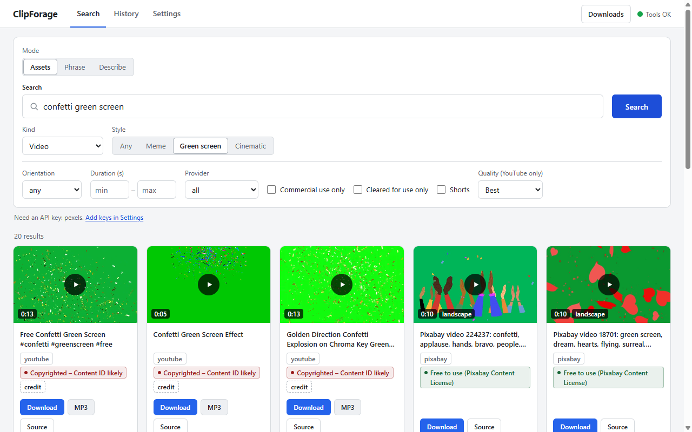

# ClipForage

[](https://github.com/Ry0x7/ClipForage-source/actions/workflows/ci.yml) [](LICENSE) [](https://www.python.org/downloads/)

One search for green-screen memes, B-roll, overlays, SFX, music, fonts and LUTs from YouTube and
free stock libraries, with the license on every result and one-click mp4/mp3 downloads.



**Status: alpha.** Search across ten sources, downloads (including clip ranges), the local web
UI, license and rights labels, safe search, fuzzy meme recall, phrase search, green-screen
key-out and DaVinci Resolve import all work and are covered by tests. Not verified yet: dropping
a file dragged from the web UI onto an editor timeline, importing transparent `.key.webm` files
into editors, the Pexels provider against its live API, and the Anthropic SDK assist backend.
Known limitations are in [docs/KNOWN_ISSUES.md](docs/KNOWN_ISSUES.md).

## How it works

- **Python 3.12**, packaged with `uv` (src layout, hatchling).
- **Typer CLI** (`clipforage`) and a **FastAPI** local web UI written in vanilla JS, both on one
  typer-free service layer.
- **yt-dlp + ffmpeg** for YouTube search, downloads, clip ranges, mp3 extraction and chroma
  key-out; ffmpeg and Deno are fetched on demand by `clipforage setup`, never bundled.
- **Provider plugin protocol**: each source is a module with `search()` and `resolve()`;
  third-party providers load through Python entry points.
- **SQLite cache** for search results (per-provider TTL), the phrase-search caption index (FTS5)
  and download history.
- **~1,200 tests** with pytest; HTTP is mocked with respx against recorded fixtures and yt-dlp
  is faked, so the suite runs offline. CI runs ruff and pytest on Ubuntu and Windows.

Design details: [docs/ARCHITECTURE.md](docs/ARCHITECTURE.md).

## What it does

- **Meme / green-screen edits:** find green-screen meme clips (YouTube via yt-dlp), meme sounds
  and music (YouTube, Freesound, Openverse), and download mp4/mp3, including clip ranges. Find a
  meme by describing it ("dog in burning room") instead of knowing its name. Key out the green
  screen into a transparent WebM.
- **Cinematic edits:** find free B-roll (Pexels, Pixabay, Mixkit, Internet Archive, Wikimedia
  Commons), filtered by orientation and duration, plus links out to free LUT packs.
- **Vlog edits:** find music and SFX, animated overlays (LottieFiles), fonts (Google Fonts) and
  images (Openverse) for intros, lower thirds and transitions.
- **License on every result:** license, attribution text, source URL, commercial-use status and
  a rights level ("Free to use", "Credit required", "Non-commercial only", "Copyrighted – Content
  ID likely", "Check license at source") are shown per result. License info is also saved in a
  sidecar `.json` next to each download.

## What works today, and what doesn't

For editors, especially short-form clippers (checked in a live run on 2026-10-06):

- **Works:** meme and green-screen search (best with `--style meme` or `green_screen`), sound
  effects, clip-range mp4 and mp3 downloads with a license sidecar, and `keyout` to a
  transparent WebM.
- **Not yet:** cleared (copyright-safe) music is thin: `--cleared-only` asks Openverse and
  Internet Archive for cleared licenses (mostly CC samples, Jamendo and netlabel tracks), and the
  big cleared music libraries are link-outs only; `--shorts` cannot tell vertical YouTube videos
  apart, so YouTube results come first unsorted; dragging onto an editor timeline is unverified; the chroma preview does not work on YouTube results. Details:
  [docs/KNOWN_ISSUES.md](docs/KNOWN_ISSUES.md).

## What it will not do

- It is not a hosted service and never proxies or re-hosts content.
- It ships no API keys, cookies or binaries; you bring your own.
- It is not a general-purpose YouTube downloader.
- It does not crawl. It scrapes only a short allowlist of sites (see
  [Scraped sources](#scraped-sources)), one throttled request per search. Every other site
  without an API is only linked (`clipforage links`).
- It does not generate memes. The optional AI assist only turns a description into search
  queries.

## Install

ClipForage is not on PyPI; install it from GitHub. Either way you need
[uv](https://docs.astral.sh/uv/) or [pipx](https://pipx.pypa.io/).

On Windows, install uv first with `winget install astral-sh.uv` (or, in PowerShell,
`irm https://astral.sh/uv/install.ps1 | iex`). uv fetches Python 3.12 itself, so you do not need
to install Python separately.

```sh
uv tool install git+https://github.com/Ry0x7/ClipForage-source
# or
pipx install git+https://github.com/Ry0x7/ClipForage-source

clipforage setup   # fetches ffmpeg + Deno into your user data dir
clipforage serve   # opens the local web UI at http://127.0.0.1:8765
```

CLI instead: `clipforage search "green screen meme" --kind video`, then
`clipforage get <provider>:<id>`. The web UI is local-only (no accounts, no auth).

### From a clone (development)

```sh
git clone https://github.com/Ry0x7/ClipForage-source.git
cd ClipForage
uv sync
uv run clipforage setup
uv run clipforage serve
```

The examples in this README assume a tool install and use bare `clipforage ...`. Contributors
working from a clone run them as `uv run clipforage ...`. See [CONTRIBUTING.md](CONTRIBUTING.md)
for tests and lint.

## Configuration

Settings live in `config.toml`:

- Windows: `%APPDATA%\clipforage\config.toml`
- macOS / Linux: `~/.config/clipforage/config.toml`

Everything is optional. The tables are `[keys]` (provider and assist API keys), `[library]`
(download folder, default `~/Downloads/clipforage`), `[download]` (quality, cookies, clip time
limit), `[search]` (safe search), `[scrape]` (scraped sources on/off) and `[assist]` (optional
AI assist). The web UI's Settings panel writes the same file.

```toml
[keys]
# pixabay = "your-pixabay-key"
# freesound = "your-freesound-key"

[library]
dir = "D:/Footage/clipforage"

[download]
quality = "1080"

[search]
safe = true
```

Each key can also come from an environment variable `CLIPFORAGE_<PROVIDER>_KEY` (for example
`CLIPFORAGE_PEXELS_KEY`), which wins over the file. Most other settings have a `CLIPFORAGE_*`
variable too, such as `CLIPFORAGE_SAFE_SEARCH` and `CLIPFORAGE_SCRAPE_ENABLED`.

## CLI commands

| Command | What it does |
|---|---|
| `version` | Print the version. |
| `doctor` | Report ffmpeg, Deno, yt-dlp, yt-dlp-ejs and (optional) Claude Code. Always exits 0. |
| `setup [--tool ffmpeg\|deno] [--force]` | Download official ffmpeg and Deno releases into the user data dir. |
| `search QUERY` | Search all providers. Options: `--kind`, `--limit`, `--style any\|meme\|green_screen\|cinematic`, `--commercial-only`, `--min-duration`, `--max-duration`, `--orientation`, `--provider`, `--no-cache`, `--no-expand`, `--no-related`, `--cleared-only`, `--unsafe`, `--shorts` (YouTube Shorts: <= 60 s on every provider, YouTube results first, then other providers portrait first; best effort). |
| `get URL\|PROVIDER:ID` | Download as mp4 (or `--mp3`) with a sidecar. Options: `--clip START-END`, `--out`, `--quality/-q best\|2160\|1440\|1080\|720\|480\|360`, `--cookies-from-browser`, `--max-wall-s`. |
| `history [--limit]` | Recent downloads, newest first, each with its `#id`. |
| `keyout ID\|FILE [--tolerance/-t 0-120] [--max-wall-s]` | Key out a green screen into a transparent VP9 WebM `<name>.key.webm`. |
| `cache-clear` | Delete cached searches and the caption index (history is kept). |
| `phrase QUERY` | Find a spoken phrase in YouTube captions / Internet Archive subtitles. Options: `--source`, `--within`, `--max-videos`, `--limit`, `--max-per-video`, `--no-cache`, `--unsafe`. |
| `recall DESCRIPTION [--kind] [--max] [--online]` | Suggest known meme names for a description (offline; `--online` also asks Know Your Meme). |
| `describe TEXT [--kind] [--style] [--backend] [--json]` | Optional AI assist: turn a description into search queries (off by default). |
| `links [--kind]` | List free sites without a search API (link-out only). |
| `resolve-import [--library] [--bin] [--only-new/--all] [--recursive]` | Import the library folder into the open DaVinci Resolve project. |
| `serve [--host] [--port] [--open/--no-open] [--reload] [--allow-remote]` | Run the local web UI. |

`clipforage <command> --help` shows every option.

### Style (`--style`)

Add `--style meme|green_screen|cinematic` (default `any`) to steer YouTube toward short meme
clips, green-screen templates or b-roll and to weight providers for that style. Meme and green
screen styles cap YouTube results at 2 min. The web UI has the same choice as a segmented
control.

```sh
clipforage search "crying cat" --kind video --style meme
```

### Quality (`get --quality`)

`--quality 720` (`best`, `2160`, `1440`, `1080`, `720`, `480`, `360`) caps the video height of
YouTube / yt-dlp downloads; the default is `[download] quality` in `config.toml`, else `best`.
Stock files have a single rendition and ignore it.

### Music and sound effects

`--kind audio_music` and `--kind audio_sfx` search YouTube too (mp3 downloads; tracks up to
15 min, sound effects up to 60 s) alongside Freesound, Openverse, Wikimedia, Internet Archive
and Mixkit (SFX). An audio search also shows a few related results of the other audio kind
(music -> SFX and back); `--no-related` turns that off.

## Fuzzy recall: find a meme by describing it

ClipForage ships an offline table of 129 well-known memes, templates and sounds with the ways
people describe them. `search` uses it automatically: a search for "dog in burning room" also
runs "this is fine" when the main search comes back short, for the meme and green-screen styles,
and for audio kinds (`also searched: ...` in the output; `--no-expand` turns it off). To just see the
suggested names:

```sh
clipforage recall "dog in burning room"
clipforage recall "crying cat" --online   # also looks the name up on Know Your Meme
```

When a search finds fewer than 3 results and scraping is enabled, it also asks Know Your Meme
for up to two meme names (entry pages only, cached 7 days).

## Rights / copyright check

Every result gets a rights level and a plain-language label, based on the license the source
reports:

| Level | Examples |
|---|---|
| `clear` | CC0, public domain, Pexels / Pixabay license, Mixkit Free |
| `attribution` | CC BY, CC BY-SA, OFL; CC BY-ND is labelled "Credit required, no edits" |
| `noncommercial` | CC BY-NC, or the source says no commercial use |
| `copyrighted` | YouTube uploads without an open license ("Copyrighted – Content ID likely"), "all rights reserved", unlicensed soundtrack uploads |
| `unknown` | No license known, Mixkit Restricted or unknown tier, LottieFiles (license not exposed) |

`--cleared-only` (web UI: "Cleared for use only", shown for every kind) keeps only `clear` and
`attribution` results. This is a heuristic on the reported license string, not legal advice:
check the source page before you publish.

## Safe search

Safe search is on by default for every search. It drops results whose title, description,
tags, collection or URL path contain a word on a blocklist (whole words only, so "Essex" and
"assess" do not match), and asks providers to filter where they can (Internet Archive adult
collections excluded, Pixabay `safesearch=true`, Openverse `mature=false`, age-restricted
YouTube entries dropped). The CLI prints `N result(s) hidden by safe search`; the web UI shows
"N results hidden by safe search · Show anyway", which re-runs that one search unfiltered.

Turn it off for one run with `--unsafe` (or the API's `safe=false`), or for good with
`[search] safe = false` in `config.toml`, `CLIPFORAGE_SAFE_SEARCH=0`, or the Settings toggle in
the web UI. It is best effort: explicit results can slip through, and harmless ones are
sometimes hidden. Ambiguous words such as "naked" or "sex" only count in titles and tags, not
in descriptions, and a short list of innocent phrases ("naked ladies", "Sex Pistols") is
ignored, so the 1954 film "Jail Bait" and the "Naked ladies" flower are no longer hidden.

## Optional AI search assist (off by default)

`describe` turns a half-remembered description ("cat crying at dinner table") into a meme
name, search queries and a rights note using a large language model. It is off until you
enable it, and search works fully without it. Enable it with `enabled = true` under `[assist]`
in `config.toml`, `CLIPFORAGE_ASSIST_ENABLED=1`, or Settings > Assist in the web UI. Then pick a
backend (`[assist] backend`, default `auto`, which tries them in this order and moves on when
one is not signed in):

- **`claude_cli`**: uses your installed [Claude Code](https://claude.com/claude-code) and its
  existing login (run `claude` once to sign in). ClipForage never sees a key. The call runs
  with every tool, MCP server and project file disabled.
- **`anthropic`**: the Anthropic Python SDK. Install the extra
  (`uv tool install "clipforage[assist] @ git+https://github.com/Ry0x7/ClipForage-source"`, or
  `uv sync --extra assist` in a clone), then set `CLIPFORAGE_ANTHROPIC_KEY` / `[keys] anthropic`,
  or sign in with `ant auth login`. This backend has not been tested against the live API yet.
- **`openai`**: bring your own key in `CLIPFORAGE_OPENAI_KEY` / `[keys] openai` (or
  `OPENAI_API_KEY`). OpenAI has no sign-in for third-party apps.

```sh
clipforage describe "cat crying at dinner table" --kind video
```

Cost: each `describe` is one model call billed to your account. Calls made through Claude Code
on the default model (`claude-opus-5-5`) cost about $0.01-0.02 each; the CLI prints the cost when
the backend reports it. Privacy: only the text you submit (plus the kind and style you chose) is
sent, to the backend you enabled, and only when you run `describe` or press Describe in the web
UI. Nothing is sent while assist is off. `[assist] model` and `timeout_s` (default 90 s) are
optional. To use a different model per backend, set `claude_cli_model`, `anthropic_model` or
`openai_model` under `[assist]` (or `CLIPFORAGE_ASSIST_<BACKEND>_MODEL`, e.g.
`CLIPFORAGE_ASSIST_OPENAI_MODEL`); it wins over the shared `model` for that backend only.

## Scraped sources

Some free sources have no API. ClipForage reads a short allowlist of them:

- **Mixkit** (`mixkit`): stock video and sound effects, one list page per search. Videos are
  "Free" or "Restricted" tier; the rights label says which, or asks you to check.
- **LottieFiles** (`lottiefiles`): animated overlays (mp4 render) and templates (Lottie JSON),
  through an undocumented GraphQL endpoint. The license is not exposed, so check each item.
- **Know Your Meme**: entry pages only, to look up meme names (never its `/search`, which
  robots.txt disallows).

Every request checks robots.txt, waits at least 1 s between requests to the same host, sends an
honest User-Agent, and results are cached for 24 h (Know Your Meme: 7 days). Turn it all off
with `[scrape] enabled = false` or `CLIPFORAGE_SCRAPE_ENABLED=0`.

**Limitation:** scraping is fragile and sensitive to each site's terms. A markup or endpoint
change makes that source fail (the search continues without it), and a site may object to
automated access at any time. Treat these sources as a convenience, not a guarantee.
Uppbeat, Videvo/Freepik, Pixabay Music, PlayPhrase, YouTube Audio Library, Zapsplat, TikTok,
Instagram Reels and the LUT sites stay link-out only; see [docs/RESEARCH.md](docs/RESEARCH.md) for why.

## Web UI

`clipforage serve` opens a local page with three modes:

- **Assets**: search grid with license and rights badges, filters, "did you mean" and "also
  searched" chips, a Related strip for audio, playable previews, a lightbox with Download / MP3
  and an optional **chroma-key preview** (tolerance slider, despill toggle), one-click download, a
  downloads drawer and history with "Show in folder" and **Key out** (transparent WebM).
- **Phrase**: find a spoken line and download just that clip.
- **Describe**: the optional AI assist; the first suggested query runs at once and the others
  are clickable chips.

Settings hold API keys, the library folder, the Assist section (enable toggle, backend, model)
and the safe-search toggle. Previews stream through the local server (`/api/media/...`); YouTube
results use a `youtube-nocookie.com` embed.

### Phrase search

Find a spoken line in YouTube captions or Internet Archive subtitles and download just that
moment: `clipforage phrase "never gonna give you up" --source youtube`, then the printed
`clipforage get <provider>:<id> --clip START-END`. Internet Archive finds films by title, so
name the film with `--within his_girl_friday` to index it first.

### Drag-out into an editor (Chrome/Edge)

After a download finishes, drag the "Saved" label, a downloads-drawer row or a history row
from the web UI into your editor or a folder. This uses Chromium's `DownloadURL` drag, so it
needs Chrome or Edge; the drop target receives a copy of the file. Dropping into an editor
timeline has not been verified yet. Folder import of the library folder always works.

### DaVinci Resolve (`resolve-import`)

With Resolve running and a project open, import the library folder into a `clipforage` media
pool bin (license and attribution go into each clip's Comments):

```sh
clipforage resolve-import   # new files only; --all, --recursive, --bin, --library
```

Setup, the in-Resolve script, `.key.webm` notes and Premiere Pro notes:
[docs/EDITORS.md](docs/EDITORS.md).

## Providers

| Provider | Kinds | Key |
|---|---|---|
| youtube (yt-dlp search) | video, audio_music, audio_sfx | none |
| openverse | image, audio | none (optional token) |
| wikimedia | image, gif, video, audio | none |
| internet_archive | video, image, audio | none |
| pexels | video, image | required |
| pixabay | video, image | required |
| freesound | audio (SFX, music) | required |
| google_fonts | font | required |
| mixkit (scraped) | video, audio_sfx | none |
| lottiefiles (scraped) | overlay, template | none |

Add keys in the web UI settings, in `config.toml`, or via `CLIPFORAGE_<PROVIDER>_KEY` (see
[Configuration](#configuration)). Klipy (GIFs/stickers) is deferred over its
terms; sites without an API (Zapsplat, Uppbeat, LUT packs, ...) are link-outs
(`clipforage links`).

## Docs

- [CONTRIBUTING.md](CONTRIBUTING.md): dev setup, conventions, adding a provider
- [docs/KNOWN_ISSUES.md](docs/KNOWN_ISSUES.md): known limitations and quirks
- [docs/ARCHITECTURE.md](docs/ARCHITECTURE.md): design and decisions
- [docs/RESEARCH.md](docs/RESEARCH.md): provider, scraping and legal research
- [docs/EDITORS.md](docs/EDITORS.md): getting downloads into DaVinci Resolve, Premiere Pro and others
- [DISCLAIMER.md](DISCLAIMER.md): legal disclaimer

## Contributing

Issues and PRs welcome; see [CONTRIBUTING.md](CONTRIBUTING.md).

## License

MIT, see [LICENSE](LICENSE). See also [DISCLAIMER.md](DISCLAIMER.md).

## Migrating from memefinder

Renamed from MemeLibraryFinder: the old `memefinder` command and `MEMEFINDER_<PROVIDER>_KEY`
variables still work, and the old config and data dirs are moved to `clipforage` on first run.
