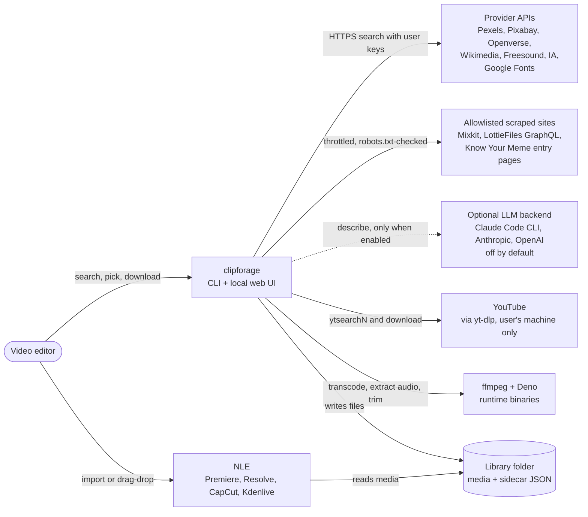
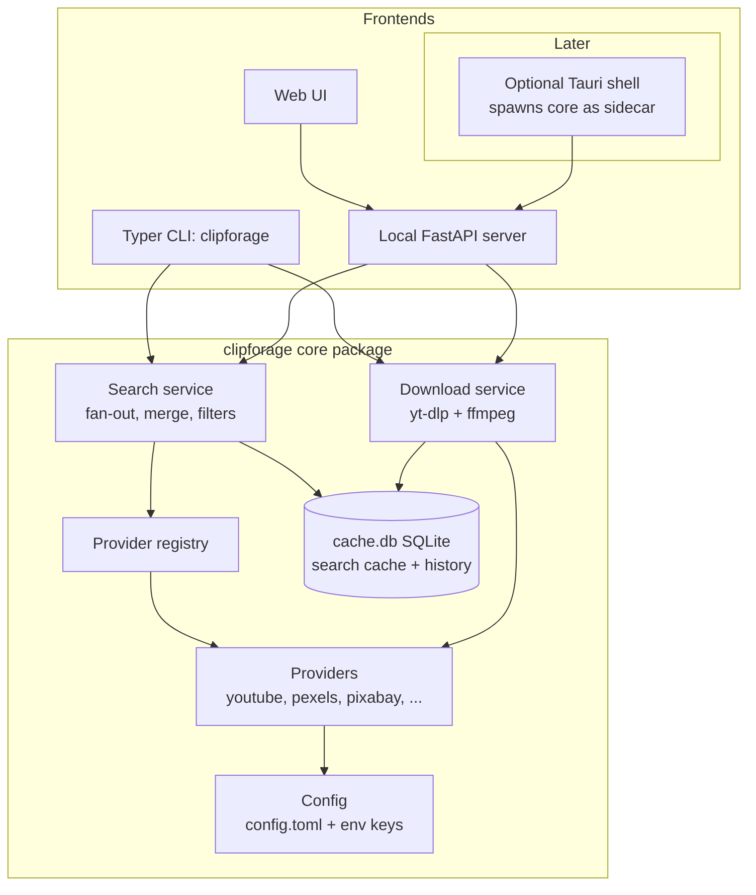
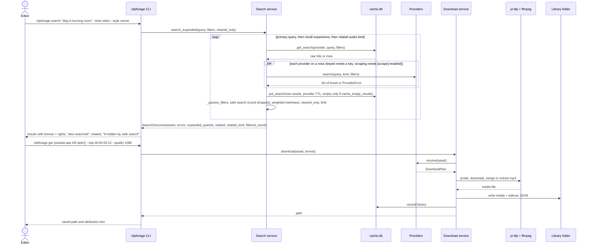

# ClipForage: Architecture

Last reviewed: 2026-10-03. C4-lite; research in [RESEARCH.md](RESEARCH.md).

## 1. Context

An editor (meme, cinematic, or vlog style) types a query: "surprised pikachu green screen", "film grain overlay", "cozy vlog music", "portrait city b-roll". clipforage fans the query out to provider APIs and to YouTube via yt-dlp, shows results with their licenses, and downloads the chosen asset into a local library folder that the NLE imports from.



## 2. Containers

Everything runs on the user's machine. There is no server we host.



## 3. Provider plugin contract

Sketch of the contract. The real models in `src/clipforage/models.py` are Pydantic `BaseModel`s
with the same fields, not dataclasses.

```python
# src/clipforage/models.py
from dataclasses import dataclass, field
from datetime import datetime
from enum import StrEnum
from pathlib import Path
from typing import Literal

class Kind(StrEnum):
    VIDEO = "video"
    IMAGE = "image"
    GIF = "gif"
    STICKER = "sticker"
    AUDIO_SFX = "audio_sfx"
    AUDIO_MUSIC = "audio_music"
    FONT = "font"
    LUT = "lut"
    OVERLAY = "overlay"
    TEMPLATE = "template"

Orientation = Literal["landscape", "portrait", "square"]

@dataclass(frozen=True)
class SearchFilters:
    kind: Kind
    commercial_only: bool = False
    min_duration: float | None = None  # seconds
    max_duration: float | None = None
    orientation: Orientation | None = None  # vlog (landscape) vs shorts (portrait)
    license: str | None = None  # e.g. "CC0-1.0"

@dataclass(frozen=True)
class Asset:
    provider: str
    id: str
    kind: Kind
    title: str
    source_url: str
    preview_url: str | None    # thumbnail IMAGE url only (never audio/video), or None
    media_url: str | None      # small directly playable preview (mp4/webm/mp3/ogg), never full-res
    media_type: str | None     # MIME of media_url: "video/mp4", "audio/mpeg", "audio/ogg", ...
    license: str               # SPDX-ish id ("CC0-1.0", "CC-BY-4.0", "Pexels") or "unknown"
    attribution_text: str
    commercial_ok: bool | None # None = unknown
    duration_s: float | None = None
    orientation: Orientation | None = None
    extra: dict = field(default_factory=dict)

@dataclass(frozen=True)
class DownloadPlan:
    asset: Asset
    method: Literal["http", "ytdlp"]
    url: str
    ext: str                   # "mp4", "mp3", "gif", "png", ...
    headers: dict[str, str] = field(default_factory=dict)
    ytdlp_opts: dict = field(default_factory=dict)

@dataclass(frozen=True)
class DownloadResult:
    path: Path
    sidecar: Path
    fetched_at: datetime

# src/clipforage/providers/base.py
from typing import Protocol, runtime_checkable

@runtime_checkable
class Provider(Protocol):
    id: str
    kinds: frozenset[Kind]
    requires_key: bool

    def search(self, query: str, kind: Kind, filters: SearchFilters) -> list[Asset]: ...
    def resolve(self, asset: Asset) -> DownloadPlan: ...
    # Optional: providers may define download(plan, dest) -> DownloadResult;
    # otherwise the download service handles "http" and "ytdlp" plans.
```

The search service applies filters a provider cannot express server-side (e.g. `commercial_only` drops `commercial_ok` False/None). Results are interleaved round-robin across providers (1st of each in registry order, then 2nd of each, ...) before the limit is applied, so one large provider cannot fill every slot.

The interleave is weighted by `filters.style` (`service.provider_weight`, merged by `interleave_weighted`): a provider of weight N contributes up to N items per round, heavier providers first within a round. `meme` / `green_screen`: youtube 3, pexels 2, pixabay 2, openverse 1, wikimedia 0, internet_archive 0. `cinematic`: pexels 3, pixabay 3, youtube 2, the rest 1. `any`: all 1 (plain round-robin). Weight 0 demotes a provider: its results are appended after all weighted results (round-robin among demoted providers), so with a `limit` they usually fall off. Unlisted providers weigh 1; a single `--provider` search is unaffected. Audio kinds use a per-kind table instead of the style (`_KIND_WEIGHTS`): `audio_sfx` freesound 3, openverse 2, youtube 2, internet_archive 1, wikimedia 1; `audio_music` freesound 2, youtube 2, the rest 1 (openverse stays 1: with `cleared_only` it still often has no cleared hits, e.g. none for "phonk"), so cleared sources come before YouTube (Content ID risk).

Discovery: `providers/registry.py` registers the in-repo provider classes, then third-party plugins from the `clipforage.providers` entry point group (see below).

### Provider plugins

Third-party packages can add providers without forking. `registry.load_builtins()` registers the built-ins, then calls `registry.load_plugins()`, which iterates `importlib.metadata.entry_points(group="clipforage.providers")` and then the pre-rename group `memefinder.providers` (`LEGACY_PLUGIN_GROUP`, same isolation; an entry point name already seen in the new group is skipped).

- An entry point may load a `Provider` instance, a Provider class, or a zero-arg factory returning one; the result must pass `isinstance(obj, Provider)` (the Protocol is `runtime_checkable`).
- Built-ins are registered first, so a plugin reusing a built-in id is rejected as a duplicate.
- Failures are isolated per plugin: an import error, a factory exception, a non-Provider object or a duplicate id is reported as `plugin <name>: <reason>` (default: `clipforage` logger warning) and the other plugins still load.
- Each entry point is processed once per process (idempotent); `load_plugins()` returns the ids it registered.
- Plugins run in-process as trusted code (no sandboxing); install only packages you trust.

```toml
# the plugin package's pyproject.toml
[project.entry-points."clipforage.providers"]
demo = "mf_demo:DemoProvider"
```

How to add a provider in 5 steps:

1. Create `src/clipforage/providers/<id>.py` with a class implementing `Provider`.
2. Map the source's license field to an SPDX-ish id, `commercial_ok`, and `attribution_text`; use `"unknown"` / `None` when unsure.
3. Read the key via `config.get_key("<id>")`; set `requires_key`, and set the provider's cache TTL if its ToS requires one.
4. Register it in `providers/registry.py`.
5. Add recorded JSON fixtures under `tests/fixtures/<id>/` and respx-based unit tests.

Built-in providers (`registry.load_builtins()`): `youtube`, `pexels`, `pixabay`, `openverse`, `wikimedia`, `freesound`, `internet_archive`, `google_fonts`, and the scraping providers `mixkit` and `lottiefiles` (section 5, "Scraping layer"). `klipy` is deferred (ToS); Giphy and Coverr are BYO-key optional and not implemented.

Empty results. A provider's empty result is not cached unless it sets `cache_empty_results = True` (pixabay, internet_archive, google_fonts, mixkit, lottiefiles: stable endpoints, and Pixabay's 24h caching terms); for the others an empty answer is often a transient failure (e.g. a yt-dlp hiccup) that would hide the provider for its whole TTL. `Cache.get_search` also treats a cached empty result older than `EMPTY_RESULT_TTL_S` (120 s) as a miss unless the provider opted in.

HTTP providers share one `httpx.Client` (project User-Agent) from `clipforage/http.py` (`get_client()`).

YouTube search (`providers/youtube.py`) is style-aware. `SearchFilters.style` (`any | meme | green_screen | cinematic`) appends an intent term to the query unless it is already there (`meme` adds " meme", `green_screen` adds " green screen", `cinematic` adds " cinematic b-roll"; `any` leaves it alone), and the augmented query is stored in `Asset.extra["search_query"]`. Without an explicit `max_duration`, each style has a default cap: 120 s for meme and green_screen, 600 s for cinematic and any. The provider over-fetches `max(3 * limit, 20)` entries (at most 60; `SearchFilters.limit` comes from the request limit), then drops live/upcoming entries, entries without a duration, and anything outside the min/max duration, keeping YouTube's order. When the cap is 240 s or less it searches `https://www.youtube.com/results?search_query=<q>&sp=EgQQARgB` (type=video, under 4 minutes) with `playlistend`; otherwise it uses `ytsearchN:<q>`. Caveat: `sp=` is an undocumented YouTube protobuf filter code that could change or stop working at any time. If it does, the post-filter still enforces the cap, but you get fewer results. `SearchFilters.shorts` (`--shorts`, API `shorts=true`; video only, ignored for audio and by other providers) appends " shorts" unless the query already has the word, lowers the cap to `min(cap, 60)` (so the under-4-minutes URL is used), raises `playlistend` to `min(3 * pool, 90)` because most of those results run over 60 s, and stable-sorts portrait results first. Portrait-first is best effort: orientation is only known for entries with a `/shorts/` URL, which the under-4-minutes results URL rarely returns (0 of 270 flat entries on 2026-10-06; they carry no width/height either). Across providers, `service._order_for_shorts` puts YouTube results first (merged order), then the other providers' results with portrait first (stable); `cinematic` skips the YouTube grouping and keeps only the stable portrait-first sort.

Audio on YouTube. `youtube` also serves `audio_music` and `audio_sfx`: the same search without the style term, duration caps of 900 s (music) and 60 s (SFX), and a `resolve()` plan that downloads mp3 (yt-dlp FFmpegExtractAudio). The rights check labels these "Copyrighted – Content ID likely".

Link-out directory (`linkout.py`, shown as links, never searched or scraped): Videvo (now Freepik Videos), Zapsplat, Uppbeat, YouTube Audio Library, Pixabay Music, RocketStock free LUTs (now a Shutterstock blog post), IWLTBAP free LUTs, PlayPhrase (quote lookup), TikTok and Instagram Reels (browse only; nearly all content copyrighted). Mixkit and LottieFiles were link-outs until 2026-10-03 and are now scraping providers. Why the rest stay link-outs: [RESEARCH.md](RESEARCH.md#scraping-feasibility-2026-10-03).

## 4. Main data flow



The sidecar `<file>.json` holds `license`, `attribution_text`, `source_url`, `provider`, `fetched_at`.

Progress hooks get plain dicts. `download_url`, `download_http`, `download_http_clip` and
`key_out` each end with exactly one `download.service.finished_event` (`status` `finished`,
`fraction` 1.0); yt-dlp's per-file `finished` events carry no `fraction`, so a consumer detects
the single terminal event by `FINAL_FRACTION_KEY` (the CLI prints `downloading done` only then).

Search flow in words (`service.search_expanded`, used by CLI `search` and `GET /api/search`):

1. Primary search with `service.search`: `registry.search_each` per provider (cache lookup,
   live search on a miss, store), then `_passes_filters` (commercial-only, duration,
   orientation), then safe search (dropped assets collected), then the style/kind-weighted
   interleave, then `cleared_only`, then the limit (`budget` = limit, default 20).
2. Expansions (section 5, "Recall and expansion") when `filters.expand` and the primary result
   is short, the style is meme / green_screen, or the kind is audio. Each expansion runs with
   `max(budget // 2, 5)`; only unseen `(provider, id)` results are added, up to `2 * budget`.
   For an audio kind and a query of two or more words, off-topic primary results are stably
   moved to the end (`relevance.demote_off_topic`): a `RELATED_NOISE_PATTERNS` title, or no
   content token shared with the query and a length unknown or over 600 s (music) / 60 s (SFX).
3. Related: for an audio kind with `filters.related`, the other audio kind is searched into
   `related` (`RELATED_LIMIT` 6). Related results are noise-filtered (`relevance.py`):
   `max_duration` is capped at 600 s for music and 60 s for SFX (unknown lengths kept), and
   titles matching `RELATED_NOISE_PATTERNS` (DJ mix, mixtape, audiobook, podcast, "N hours",
   ...) are dropped.
4. `filtered_count` is the number of distinct `(provider, id)` results safe search dropped across
   all of these calls. Provider errors are de-duplicated (same provider + message once).

Quality (`get --quality/-q`, `/api/download` `quality`, web UI `Quality` select). Values are
`models.QUALITIES`: `best` (no cap, the plain `MP4_FORMAT`) or a max height `2160`, `1440`,
`1080`, `720`, `480`, `360`. `video_format_for` adds `[height<=N]` to every `bv*` / `b` clause
of `MP4_FORMAT` and keeps a bare `b` last, so a source without a small enough rendition still
downloads. `build_ydl_opts` / `download_url` / `download_plan` take `quality`; mp3 ignores it
(always 192 kbps), and `http` plans (stock files, http clips via ffmpeg) are a single rendition
and ignore it. `service.resolve_quality` uses the explicit value, else `[download] quality` /
`CLIPFORAGE_QUALITY` (legacy `MEMEFINDER_QUALITY`), else none (best); `download_ref` only reads
the setting for `ytdlp` plans. A bad value raises `RefError` (service, CLI `error:` exit 1) or
`DownloadError` (downloader); the API rejects it with 422. The sidecar records `quality`
(`best` when none) for yt-dlp downloads. `GET /api/settings` lists `qualities`.

Clip ranges (`get --clip START-END`, `/api/download` `clip`). `ytdlp` plans use yt-dlp
`download_ranges`. Plain `http` video/audio plans (Internet Archive, Pexels, Pixabay, Wikimedia)
go through `download_http_clip`: ffmpeg reads the remote URL directly (input `-ss`/`-to`, our
User-Agent, `plan.headers`) and re-encodes to h264/aac `.mp4` (CRF 20, `veryfast`) or, for audio
plans, to `.mp3`, named `<title> [<id>] <start>-<end>.<ext>` (`clip_label`: seconds with up to
3 decimals, e.g. `12.3-15.8`; a taken name gets ` (2)`, ` (3)`, ...; yt-dlp clips use the same
label in their outtmpl); the sidecar gets `clip`. http(s)
inputs get `-rw_timeout` 30 s plus `-reconnect`, and a `CLIP_MAX_WALL_S` (300 s) watchdog kills
ffmpeg and raises `DownloadError`. The limit is `max_wall_s` on `download_http_clip` /
`download_plan` / `service.download_ref`, `get --max-wall-s`, `/api/download` `max_wall_s`
(0-7200; a web UI phrase-mode field) or `[download] clip_max_wall_s` /
`CLIPFORAGE_CLIP_MAX_WALL_S` (number or numeric string, read when none is passed); `0` disables it. Progress is a time `fraction` (CLI `clipping N%`, job
`progress`). `service.CLIP_KINDS` (video, audio_sfx, audio_music) decides where a clip is
allowed (CLI and web); other kinds are rejected; `mp3` stays yt-dlp only.

Chroma-key export (`keyout REF`, `POST /api/library/{id}/keyout`, history `Key out` button).
`download.service.key_out` re-encodes a local video (mp4/webm/mkv/mov) with ffmpeg
`-vf chromakey=color=0x00FF00:similarity=S:blend=0.1,despill=type=green` and `KEY_VIDEO_ARGS`
(libvpx-vp9, `yuva420p`, `-auto-alt-ref 0`, CRF 30, libopus, WebM) into `<stem>.key.webm` beside
the source (`<stem> (2).key.webm`, ... if taken; `.part` first).
`chroma_filter` maps the preview's tolerance
(0-120, default 80, higher keys more) to `S = 0.05 + 0.35 * t / 120` (3 decimals). Progress is a
time `fraction` from the input `Duration:` line (CLI `keying N%`); the same wall-clock watchdog
as clips applies (`max_wall_s` / `--max-wall-s` / `[download] clip_max_wall_s`).
`service.key_out_download(history_id)` copies the source sidecar's license meta (and extras like
`clip`), adds `format: webm`, `derived_from` and `chroma`, and records a new history row with the
source row's `url`; `service.key_out_path` (CLI file paths) writes a sidecar only if the source
has one and records no history. `history` prints the row id first (`#12  ...`). Players that use
ffmpeg's native vp9 decoder report `yuv420p` plus `alpha_mode: 1`; the alpha plane is decoded
with libvpx-vp9 (`ffmpeg -c:v libvpx-vp9 -i x.key.webm`, which reports `yuva420p`).

## 5. Cross-cutting concerns

Config & keys (D5). Keys come from `%APPDATA%\clipforage\config.toml` (Windows), `~/.config/clipforage/config.toml` (others), or env `CLIPFORAGE_<PROVIDER>_KEY` (pre-rename `MEMEFINDER_<PROVIDER>_KEY` is the fallback, via `config._env`); env wins. Nothing is shipped. Providers without a key are hidden from search, and the CLI prints a one-line hint on how to add one.

Cache & TTL (D6). `cache.db` (SQLite, user data dir: `%LOCALAPPDATA%\clipforage` on Windows, `~/.local/share/clipforage` or `$XDG_DATA_HOME/clipforage` elsewhere) stores search responses keyed by provider + query + kind + filters, with a per-provider TTL: Pixabay 24h (ToS), the scraping providers and Internet Archive / Google Fonts 24h, default 1h. The filters (including `safe`) are part of the key. The cache stores raw provider results; filters and safe search are applied again on every cache hit. Empty results follow the `cache_empty_results` rule (section 3). A generic blob table holds the Know Your Meme lookups (7 days). It also records download history. Downloads go to a user-chosen library folder.

Rename migration. The project was renamed from MemeLibraryFinder (`memefinder`) to ClipForage. `config.migrate_legacy_dirs()` runs from the CLI callback and from `create_app()`: if the `clipforage` config or data dir is missing and the old `memefinder` sibling exists, it is moved (renamed) to the new name; if the move fails, only `config.toml` is copied and a warning is printed to stderr. `~/Downloads/memefinder` is never moved: it stays the default library while `~/Downloads/clipforage` does not exist. A deprecated `memefinder` console script prints a one-line notice and runs `clipforage`.

Runtime binaries (D4). ffmpeg and Deno are not committed. `clipforage doctor` checks PATH and the user data dir for ffmpeg, Deno, and the yt-dlp version. `clipforage setup` downloads official releases into the `bin/` subfolder of the user data dir (Stacher / Media Downloader pattern); data-dir binaries win over PATH. Cookies-from-browser is opt-in: `clipforage get --cookies-from-browser BROWSER[+KEYRING][:PROFILE][::CONTAINER]`, or `[download] cookies_from_browser` in `config.toml`, or env `CLIPFORAGE_COOKIES_FROM_BROWSER` (legacy `MEMEFINDER_COOKIES_FROM_BROWSER`; env wins over the file; the CLI flag wins over both). The bgutil PO-token provider is opt-in only (not implemented).

Logging & errors. Each provider search runs isolated with a timeout; one provider failing never fails the whole search: its error becomes a warning row. yt-dlp breakage (bot check, missing JS runtime, extractor error) is caught and surfaced with a clear message and the fix ("run `clipforage doctor`", "update yt-dlp"), not a stack trace. `--verbose` adds debug logs.

Testing. pytest unit tests use recorded JSON fixtures served through respx; CI makes no live network calls. Real-API tests carry an opt-in `live` pytest marker and are skipped by default. ruff for lint/format.

### Recall and expansion

`recall.py` is offline and deterministic. `providers/data/meme_aliases.json` holds 129 entries
(`name`, `aliases`, optional `kinds` and `tags`). `expand_query(query, kind, max_expansions=3)`
tokenizes (lowercase, light stemming, stopwords such as "meme", "sound", "green screen" words
dropped), scores each entry by IDF-weighted coverage of the query tokens (minimum
`MIN_COVERAGE` 0.6) plus `PHRASE_BONUS` 0.3 when a whole alias phrase matches, and returns the
best entry names. `core_query` strips audio filler ("undertale bgm" -> "undertale"; for audio
kinds also "meme", "template", "green screen"). `related_audio_kind` maps music <-> SFX.

`recall_online.py` is the online half: `kym_lookup` slugifies the query (plus up to two offline
names), GETs `https://knowyourmeme.com/memes/<slug>` through `scrape.py`, and reads the entry
title and the `<strong>` aliases of its first About paragraph. KYM's `/search` is disallowed by
robots.txt and never requested. Hits and misses are cached 7 days in `cache.db` (`blob_cache`).
With a cache, `load_slugs` also fetches the confirmed-memes sitemap
(`https://knowyourmeme.com/memes/confirmed/sitemap.xml`, one urlset of about 23k URLs, ~3.7 MB
decoded, slow to start: ~35 s to the first byte, so `SITEMAP_TIMEOUT_S` is 90 s) at most once per
7 days. It keeps the `/memes/<slug>` entries (about 16k) and, separately, the
`/sensitive/memes/<slug>` entries (about 2.3k, e.g. `woman-yelling-at-a-cat`); the
`/memes/people|events|subcultures|sites|cultures/` entries and non-ASCII slugs are skipped. Both
lists are stored as `{"memes": [...], "sensitive": [...]}` under `knowyourmeme:_sitemap_v3` (a
payload of any other shape is refetched), and a failed fetch is remembered for an hour. A sitemap
index is followed for at most 10 children, with caps of 50,000 slugs and 20 MB. Sensitive slugs
are fuzzy candidates only with safe search off (`kym_lookup(safe=False)`: `--unsafe`,
`safe=false`, or `[search] safe = false`); exact slugs reach sensitive entries either way through
KYM's 301. Because the sitemap is slow, `load_slugs(block=False)` (the default for
`search_expanded` and `GET /api/recall`) returns no slugs on a miss and starts one background
daemon thread (module lock, at most one in flight) that fetches and stores it, so that lookup has
exact candidates only. `clipforage recall --online` blocks instead and prints
"building Know Your Meme index (first run, about 40 s)" to stderr when it has to fetch. A CLI
`search` process usually exits before the background fetch finishes, so the index is built by
`recall --online` or a running `serve`.
`fuzzy_slugs` ranks those slugs by how many query key words they share (3+ letters, not
`the a of and in meme`), breaking ties with `difflib.SequenceMatcher`. With 2+ key words a
candidate must share at least 2, or be a near spelling of the whole query (ratio >= 0.8 on the
full slug, so "distracted boyfreind" still finds `distracted-boyfriend`); with one key word
sharing it is enough. Up to 3 of them are fetched after the exact candidates, so a lookup makes
at most 6 entry requests. Matching takes ~10 ms over the real list.

In `search_expanded`, expansions are the offline names of the raw query and of `core_query`
(at most `MAX_EXPANSIONS` 3); when the primary search found fewer than `KYM_MIN_RESULTS` (3)
and scraping is enabled, up to `KYM_MAX_NAMES` (2) Know Your Meme names are appended. A KYM
failure becomes a `knowyourmeme` provider error, not a failed search. For the related audio
kind, the core query is searched first; if that finds nothing the raw query is tried; for a
one-word related SFX query, `"<word> sound effect"` fills up the strip. Surfaces: `clipforage
recall [--online] [--unsafe]`, `GET /api/recall?q&kind&online&safe` (offline unless
`online=true`), and the
`expanded_queries` / `related` fields of `/api/search`.

### Rights classification

`rights.classify(asset) -> Rights(level, label, detail)` walks a rule table top to bottom; the
first match wins. Levels (`models.RightsLevel`): `clear`, `attribution`, `noncommercial`,
`copyrighted`, `unknown`. Rule order: non-commercial (`NC` / "non-commercial" in the license);
YouTube audio without an open license ("Copyrighted – Content ID likely"); other YouTube without
an open license (same label); "all rights reserved" / standard YouTube / fair use; Mixkit tier
unknown ("Check Mixkit tier at source", `unknown`); Mixkit Restricted (`unknown`); Mixkit Free
(`clear`); LottieFiles ("Lottie Simple License (unverified)", `unknown`); CC0 / public domain /
Pexels / Pixabay (`clear`); CC BY-ND ("Credit required, no edits", `attribution`); other
attribution licenses (CC BY, OFL, Apache, MIT, UFL, GPL); `commercial_ok is False`
(`noncommercial`); audio with an unknown license whose title or description reads like a
soundtrack rip (OST, BGM, theme song, ...: `copyrighted`). Fallback: "Check license at source"
(`unknown`). Every `/api/search` asset carries `rights` (`schemas.AssetOut`); the CLI prints the
label. `cleared_only` (`--cleared-only`, API `cleared_only`) keeps `clear` and `attribution`
only and is applied in `service.search` before the limit. `service.search` also sets
`SearchFilters.cleared_only` so providers can narrow the query: Openverse sends
`license=cc0,pdm,by,by-sa` and `license_type=commercial`; Internet Archive audio adds
`licenseurl:* AND NOT licenseurl:*nc*`. The post-filter stays the final gate. In
`search_expanded`, a cleared-only audio search with no primary results is retried once with
`relax_query` (generic words such as "background", "music", "sound effect" stripped); the
outcome's `relaxed_query` (CLI line, `SearchResponse.relaxed_query`) names the query shown. It is a heuristic
on the reported license string, not legal advice.

### Safe search pipeline

On by default: `SearchFilters.safe` comes from `--unsafe` / API `safe` if given, else
`[search] safe` / `CLIPFORAGE_SAFE_SEARCH` (`safesearch.configured_safe()`, default true).
`PUT /api/settings/search` writes the setting. Where it applies:

1. Provider knobs, when `filters.safe`: Internet Archive appends `AND NOT` clauses for the 23
   adult collections (including `no-preview`) and 7 explicit subjects of
   `providers/data/safesearch_terms.json`; Pixabay sends `safesearch=true`; Openverse sends
   `mature=false` and drops hits marked `mature`; YouTube drops entries with `age_limit >= 18`
   (best effort and verified inert on 2026-10-03: flat search results carry no `age_limit`, so
   YouTube relies on the shared post-filter below).
2. Shared post-filter in `registry.search_each`, after `_passes_filters`, for live results and
   cache hits alike (the cache keeps raw results): `safesearch.is_explicit` matches blocklist
   terms as whole words (text lowercased, non-alphanumeric runs become one space). Two tiers:
   the 95 strong `terms` match the title, `extra` `description` / `tags` / `subject` /
   `collection` / `categories` and the `source_url` path; the 47 `mild_terms` (ambiguous words
   such as "naked", "sex", "erotic", "jailbait") match the same fields except the description
   and the URL path (an IA identifier is a weak signal). The 11 `allow_phrases` ("naked
   ladies", "naked eye", "sex pistols", ...) are cut out of every field first, leaving a
   separator so neighbouring words do not join into a new phrase. Exact IA collection ids
   also match.
3. Dropped assets are collected; `SearchOutcome.filtered_count` counts distinct
   `(provider, id)` across primary, expansion and related searches. CLI: `N result(s) hidden by
   safe search (--unsafe to show)`; web UI: "N results hidden by safe search · Show
   anyway" (re-runs that search once with `safe=false`; "Hide again" undoes it; the setting is
   untouched).
4. Phrase search skips explicit candidates and hits the same way (`phrase --unsafe`);
   `PhraseOutcome.filtered_count` (distinct `(provider, id)` over both drop points) feeds
   `PhraseResponse.filtered_count`, the same CLI line and the same web UI line.

The tiers and allow phrases address known false positives (the 1954 film "Jail Bait", the
"Naked ladies" flower, descriptions that merely mention an ambiguous word). A strong term in a
description, or a mild term in a title or tag, still drops an asset. It is best effort, not a
guarantee.

### Scraping layer

Scraping is allowed only for an allowlist (`.claude/rules/providers.md`): Mixkit list pages
(`providers/mixkit.py`), the LottieFiles GraphQL endpoint (`providers/lottiefiles.py`) and Know
Your Meme entry pages plus its confirmed-memes sitemap (`recall_online.py`, sitemap at most once
per 7 days). Every such request goes through `scrape.py`
(`fetch_html` / `request`):

- robots.txt of the host is fetched once per process and checked before every request and on
  every redirect hop (redirects are followed by hand, at most 5); 401/403 on robots.txt means
  disallow all, a missing (other 4xx) robots.txt means allow all, and a network error or 5xx is
  logged and treated as allow all;
- per-host throttle: at least `[scrape] min_interval_s` (default and minimum 1 s) between
  requests to one host;
- the honest project User-Agent through the shared httpx client;
- one list page / one query per search, no pagination, no detail-page fan-out (extra pages only
  in `resolve()` for the single asset being downloaded);
- search results cached 24h (`SEARCH_TTL_S = 86400`, `cache_empty_results = True`).

`[scrape] enabled = false` (or `CLIPFORAGE_SCRAPE_ENABLED=0`) skips providers with
`scrapes = True` (reported as a provider error) and the KYM lookup. Mixkit: `video` (Free vs
Restricted tier from the list page's JSON-LD; items without a stated tier get
`commercial_ok=None`) and `audio_sfx` (Mixkit Sound Effects Free License). LottieFiles:
`overlay` (mp4 render) and `template` (Lottie JSON); no license field is exposed, so every item
is "Lottie Simple License (unverified)". Fragility: markup or endpoint changes make the provider
return nothing or raise `ProviderError`, and the search continues without it; a site may also
change its terms or robots.txt at any time. This is a convenience, not a guarantee.

### Assist layer (optional)

`assist/` turns a free-text description into search queries, meme names, a kind hint and a
rights note (`models.AssistResult`). It is search assistance, not generation, and is OFF by
default: `assist.describe` raises `AssistDisabledError` without contacting anything unless
`[assist] enabled = true` / `CLIPFORAGE_ASSIST_ENABLED`. Only `clipforage describe` and
`POST /api/assist` call it.

Backends (`[assist] backend`: `auto` | `claude_cli` | `anthropic` | `openai`):

- `claude_cli` (`assist/claude_cli.py`): runs the installed Claude Code CLI (`claude -p`) with
  our own `--system-prompt`, `--tools ""`, `--safe-mode`, `--strict-mcp-config`,
  `--no-session-persistence`, `--effort low`, in an empty temp dir. Reuses the user's Claude
  Code login; ClipForage never sees a key. Default model `claude-opus-5-5`.
- `anthropic` (`assist/anthropic_api.py`): the Anthropic SDK (optional extra
  `clipforage[assist]`); key from `CLIPFORAGE_ANTHROPIC_KEY` / `[keys] anthropic`, else the
  SDK's own resolution (env or an `ant auth login` profile). Default `claude-opus-5-5`.
- `openai` (`assist/openai_api.py`): Chat Completions over httpx with a BYO key
  (`CLIPFORAGE_OPENAI_KEY` / `[keys] openai` / `OPENAI_API_KEY`); OpenAI has no sign-in for
  third-party apps. Default `gpt-4o-mini`.

`auto` tries the available backends in that order and falls through to the next one only on an
auth / login error. A per-backend `[assist] <backend>_model` (`claude_cli_model`,
`anthropic_model`, `openai_model`; env `CLIPFORAGE_ASSIST_<BACKEND>_MODEL`) wins for that backend
and is used as-is (no family check). Otherwise the shared `[assist] model` overrides the default
(ignored with a warning when it is from another model family than the backend), `timeout_s`
defaults to 90. Web:
`GET /api/assist/status` (availability only, never an LLM call), `POST /api/assist` (403
disabled, 503 no backend, 502 failed or timed out), `PUT /api/settings/assist` (enabled,
backend, model, `<backend>_model`; "auto" and an empty model reset to defaults); `doctor` prints a Claude Code
line.

Cost: each call is billed to the user's account; Claude Code calls on Opus 5.5 cost about
$0.01-0.02 each (observed), and the cost is printed when the backend reports it. Privacy: the
description text (plus the chosen kind and style) is sent to the chosen backend only when
assist is enabled and the user submits a description; search never calls an LLM.

### Web layer (M3)

`clipforage serve` runs `clipforage.web.app:create_app()` under uvicorn on `127.0.0.1:8765`. It
calls the same typer-free service layer as the CLI (`service.py`: search, resolve refs, history,
provider list) and serves a vanilla-JS UI from `web/static/` (no build step, no HTMX).

Routes: `GET /` (UI), `GET /static/*`, `GET /api/providers`, `GET /api/search`,
`GET /api/preview/{provider}/{asset_id}`, `POST /api/download` (202 + job id),
`GET /api/jobs`, `GET /api/jobs/{job_id}`, `GET /api/history`, `GET /api/settings`,
`PUT /api/settings/keys/{provider_id}`, `PUT /api/settings/library_dir`, `GET /api/doctor`,
`POST /api/open` (open a library folder in the OS file manager),
`GET /api/library/{history_id}/file`, `GET /api/library/{history_id}/sidecar` (M4, see below),
`POST /api/library/{history_id}/keyout` (`{tolerance 0-120, max_wall_s}`, 202 + a `JobOut` with
`kind: "keyout"`; same 404/403 library checks as `/file`, 400 if not a video),
`GET /api/media/{provider}/{asset_id}`, `GET /api/phrase`, `GET /api/recall`,
`GET /api/assist/status`, `POST /api/assist`, `PUT /api/settings/assist`,
`PUT /api/settings/search`. `GET /api/search` takes `q`, `kind`, `limit`, `commercial_only`,
`orientation`, `min_duration`, `max_duration`, `provider`, `no_cache`, `style`, `expand`,
`related`, `cleared_only` and `safe` (omitted = the configured default) and returns `assets`
(each with `rights`), `errors`, `linkouts`, `expanded_queries`, `related`, `related_kind` and
`filtered_count`. `/` and `/static/*` are served with `Cache-Control: no-cache` so UI changes
show up without a hard reload.

UI modes: Assets (filters disclosure, rights badges, "Did you mean" recall chips, "Also
searched" chips, a Related strip for audio, the "Cleared for use only" toggle for every kind,
"N results hidden by safe search · Show anyway"), Phrase, and Describe (assist; the first suggested
query runs at once, the others are chips). Settings: keys, library folder, Assist (enable,
backend, model), safe search.

Phrase mode. `GET /api/phrase` (`q`, repeatable `source`, `within`, `max_videos` 1-25, `limit`
1-100, `max_per_video` 0-50, `no_cache`; bad values 422, unknown source 404) runs
`service.phrase_search` in FastAPI's threadpool (sync route) and returns hits with `ref` and
`clip` (= `clip_spec()`), errors, and the PlayPhrase link-out only. The UI's `Assets | Phrase`
switch groups hits by video; `Preview` seeks to the cue, `Download clip` posts `{ref, clip}`.

`GET /api/media/{provider}/{asset_id}` streams a cached asset's playable `media_url` for the
UI's `<video>`/`<audio>` (Range passthrough, 200/206; Internet Archive falls back to `resolve()`;
upstream redirects allowed only within the same site, last two DNS labels).
The lightbox has an optional chroma-key preview for video with `media_url`: it hides the
`<video>`, keys each decoded frame (max 640px wide) into a `<canvas>` via
`requestVideoFrameCallback` (fallback: `requestAnimationFrame` capped at ~30 fps), and zeroes
alpha for green-dominant pixels (`g - max(r, b) > 120 - tolerance`, soft edge) over a
checkerboard/black/white backdrop; an optional despill step (default on) clamps green to
`max(r, b)` on still-visible green-dominant pixels to remove green fringe; client-side only,
toggle + tolerance + despill kept in localStorage.

Jobs. `web/jobs.py` `JobManager` runs downloads on a `ThreadPoolExecutor` (2 workers), keeps the
last 100 jobs in memory (lost on restart), and exposes progress snapshots the UI polls. Downloads
go to `config.library_dir()` with the usual sidecar and history row. While yt-dlp's mp4 merge /
mp3 extract postprocessors run, the job's `stage` is `postprocessing` (UI shows "processing…",
progress keeps its last value); a final `finished` event with `fraction` 1.0 clears it.

Security model. Local, single-user, no authentication:
- Binds loopback only; `serve` refuses a non-loopback `--host` unless `--allow-remote` is passed.
- `TrustedHostMiddleware` rejects any `Host` other than `127.0.0.1` / `localhost` / `[::1]` with
  400 (DNS-rebinding guard). `--allow-remote` disables this check entirely (`allowed_hosts=["*"]`),
  prints a warning, and still adds no auth; it cannot be combined with `--reload`.
- Every non-GET/HEAD/OPTIONS request must carry `X-Clipforage: 1` (blocks simple cross-site form
  posts, which cannot set custom headers); the pre-rename `X-Memefinder: 1` is still accepted.
- `/api/preview` only proxies the `preview_url` of an asset already in the search cache (looked up
  by `provider:id`), http(s) only, and fails if the upstream redirects to another site. It is not
  an open proxy.
- Settings never return raw API keys, only masked values; `/api/open` only opens paths inside the
  library folder.
- `/api/library/{history_id}/file|sidecar` serve only the `path` / `sidecar` of an existing
  download-history row, and only if the resolved file is inside the library folder (403
  otherwise, 404 if the row or file is gone).

### Editor integration (M4)

The library folder (`config.library_dir()`, default `~/Downloads/clipforage`, or an existing
`~/Downloads/memefinder` from before the rename) is the stable,
flat import folder that editors watch or import from. There is no Python-side folder watcher
(decision): every editor already has folder import, and watching would add a long-running
process for no gain.

Drag-out. When a download finishes, `service.record_history` returns the new history row id
and `web/jobs.py` puts it on the job (`history_id`). The UI makes the "Saved" card state, the
downloads-drawer row and each history row draggable. On `dragstart` it sets
`DownloadURL` (`<mime>:<filename>:<url>`, Chromium only: Chrome/Edge), `text/uri-list` and
`text/plain`, all pointing at `GET /api/library/{history_id}/file`, which streams the file
(`FileResponse`, Range-aware, `Content-Disposition: inline` with an RFC 5987 `filename*` for
non-ASCII names). The drop target fetches that URL and writes a copy; Explorer copies the
file rather than referencing the library file. While a drag is in progress the UI does not
re-render the downloads drawer. Search responses also carry `history_id` / `history_path` on
each result whose newest download (`Cache.latest_download_for_asset`) still exists in the
library folder, computed per response and never cached, so a re-rendered card gets the same
"Saved" handle. The payload is verified; a real OS drop into an editor is not.

DaVinci Resolve. `editors/resolve.py` uses Resolve's scripting API (`DaVinciResolveScript`,
loaded lazily in `connect()`, so the module imports without Resolve). It fills
`RESOLVE_SCRIPT_API` / `RESOLVE_SCRIPT_LIB` from the documented default install paths when
unset, lists the library's media files (no sidecars, partial downloads or hidden files),
imports new ones into a `clipforage` bin of the current project with one `ImportMedia` call
(plain path strings first, `{"FilePath": ...}` dicts as a retry), and writes
`<license> | <attribution_text> | <source_url>` from the sidecar into the clip's Comments
(else Description) metadata. It returns an `ImportReport` (`models.py`). The CLI command
`clipforage resolve-import [--library] [--bin] [--only-new/--all] [--recursive]` wraps it.
`scripts/resolve/clipforage_import.py` is a standalone copy of the same logic for Resolve's
Workspace > Scripts menu that does not need clipforage installed. Details:
[EDITORS.md](EDITORS.md).

Premiere Pro. A UXP panel spike ([PREMIERE_UXP_SPIKE.md](PREMIERE_UXP_SPIKE.md)) concluded
GO-LATER; the untested skeleton lives in `spikes/premiere-uxp/`. `spikes/` holds throwaway
research code that is not part of the package or the test suite.

### Phrase search

`clipforage phrase QUERY` finds a spoken phrase in captions and returns timestamped hits that
can be downloaded as clips. It only reads sources clipforage already uses (YouTube captions,
Internet Archive subtitle files); nothing is hosted and nothing is scraped. PlayPhrase is a
link-out only.

Flow (`service.phrase_search`):
1. Candidates per source, up to `max_videos`: youtube = `YouTubeProvider.search` (style `any`,
   so the usual 10-minute cap applies), or with `--within <URL>` the flat entries of that
   playlist / channel / video (`YouTubeProvider.assets_from_url`, no duration cap);
   internet_archive = `InternetArchiveProvider.search_with_subtitles` (Advanced Search,
   `({query}) AND mediatype:movies AND (format:"SubRip" OR format:"Web Video Text Tracks")`).
   IA search matches item metadata, not subtitle text, so IA finds films by title: with
   `--within`, an identifier-like value (`^[A-Za-z0-9_.-]+$`) is queried as
   `identifier:<within>` first, else (or on no result) as a title search; without
   `--within`, the query itself is searched and, if nothing matches, the most-downloaded
   subtitled `collection:feature_films` items are indexed instead (empty query to
   `search_with_subtitles`). Quotes then match inside films already indexed; each run grows
   the local index.
2. For each candidate without fresh captions (or all, with `--no-cache`), `phrase/captions.py`
   fetches a track: YouTube via the yt-dlp Python API (`writesubtitles`, `writeautomaticsub`,
   langs `en`, `en-orig`, `en.*`, format `vtt`; the first `requested_subtitles` entry is
   fetched with the shared httpx client; `auto_generated` = the lang is only in
   `automatic_captions`); Internet Archive via the Metadata API (first `.vtt` / `.srt`,
   English-named files first; `*.asr.*` speech-recognition files are `auto_generated`). `phrase/subtitles.py` parses VTT/SRT into `Cue`s, strips tags
   and entities and collapses YouTube's rolling auto-caption repeats.
3. Cues are stored with `Cache.put_captions` (an empty list is stored too, so videos without
   captions are not refetched). A failed fetch is a `warn` and is retried next run; a failed
   source becomes a `ProviderError`.
4. `Cache.search_captions` runs over the whole index (videos indexed by earlier runs count),
   the query quoted as one FTS5 phrase, ordered by `bm25`, then `start_s`. `put_captions`
   stores one row per sliding window of 1, 2 and 3 consecutive cues
   (`cache.CAPTION_WINDOW_MAX = 3`; text joined by spaces, first cue start to last cue end,
   `span` = cues in the row) so a phrase split across up to three caption lines matches; a
   row is dropped when a matching row of the same asset with a smaller `span` lies inside its
   range (the narrowest window wins), exact duplicates are dropped, then at most
   `max_per_video` hits per video are kept (0 = no cap) before `limit` (rows are over-fetched
   4x, more if needed).
5. Hit assets are written to the search cache (`phrase:<query>` key, provider TTL) so the
   printed `clipforage get <provider>:<id> --clip START-END` resolves.

Tables in `cache.db` (created on first phrase use; FTS5 missing raises
`cache.CaptionIndexUnavailableError`, a `sqlite3.Error`, reported as `cache unavailable`):
`caption_sources(provider, asset_id, lang, auto, fetched_at, ttl_s, asset_json,
PRIMARY KEY(provider, asset_id))` and the FTS5 table
`captions(text, provider UNINDEXED, asset_id UNINDEXED, start_s UNINDEXED, end_s UNINDEXED,
span UNINDEXED)`. An index without the `span` column (older schemas, with or without the
former boolean `joined` column) is dropped and rebuilt (its videos are refetched on the next
run).
Captions are fresh for `CAPTIONS_TTL_S` (7 days); expired ones stay searchable until
refetched. `clipforage cache-clear` also clears the caption index.

Contracts (the web layer builds on these):
- `models.Cue(start_s, end_s, text)` and `models.PhraseHit(asset, start_s, end_s, text,
  lang=None, auto_generated=False)`, both frozen; `PhraseHit.ref` is `<provider>:<id>`;
  `PhraseHit.clip_spec(pad_s=1.0)` is `"START-END"` in seconds with one decimal, start clamped
  at 0, parseable by `download.service.parse_clip`.
- `service.phrase_search(query, *, sources=None, within=None, max_videos=10, limit=20,
  use_cache=True, warn=None, max_per_video=3, safe=None) -> PhraseOutcome` (`hits`,
  `errors`, `filtered_count`);
  `service.PHRASE_SOURCES = ("youtube", "internet_archive")`. Unknown source: `LookupError`;
  cache.db / FTS5 unavailable: `CacheUnavailableError`.

Limits: a quote alone does not find an Internet Archive film that is not indexed yet; name
the film with `--within`. Phrases spanning four or more caption lines are not matched.
Auto-captions (YouTube, and IA `.asr.srt` files) contain recognition errors. Internet Archive
clips (`get internet_archive:<id> --clip`) go through the ffmpeg HTTP clip path (section 4).

## 6. Decisions

| ID | Decision | Alternatives rejected | Why |
|---|---|---|---|
| D1 | Python 3.12+, uv, `src/clipforage/`, Typer CLI, pytest, ruff; later FastAPI + web UI, then optional Tauri sidecar shell | Node/ytdl-core forks; pure Rust | yt-dlp is Python; Node forks unmaintained; Rust has no yt-dlp |
| D2 | `Provider` Protocol + in-repo registry; `clipforage.providers` entry points; 10 asset kinds; license fields on every `Asset` | Monolithic search module | Sources churn (Tenor died); licenses vary per item |
| D3 | Providers: youtube (video + audio), pexels, pixabay, openverse, wikimedia, freesound, internet_archive, google_fonts; klipy deferred (ToS); throttled scraping only for an allowlist (mixkit, lottiefiles, KYM entry pages); link-outs for every other no-API site | YouTube Data API; Tenor; Giphy default; general scraping / crawling | Quotas, shutdowns, paid keys, ToS bans; the allowlist was a deliberate decision (2026-10-03), accepting fragility |
| D4 | yt-dlp Python API + ffmpeg; binaries fetched by `setup`, checked by `doctor` | Committing binaries; imageio-ffmpeg only | Repo size, licensing, Deno now required |
| D5 | User-supplied keys in config.toml or env | Shipping keys; hosted key proxy | ToS; keys would leak and get revoked |
| D6 | SQLite cache with per-provider TTL + history; library folder with sidecar JSON | No cache; NLE-specific import first | Pixabay 24h rule; quotas; folder import works everywhere |
| D7 | Parabolic/cobalt-style disclaimer; license and rights level on every result; BY-NC flagged; no hosting | "YouTube downloader" branding; hosted service | YouTube ToS; youtube-dl DMCA history |
| D8 | Optional LLM assist, off by default; backends Claude Code CLI, Anthropic SDK, OpenAI BYO key; search assistance only | Always-on assist; shipped keys; meme generation | Cost and privacy stay the user's choice; search must work without it |
| D9 | Safe search on by default: shared blocklist post-filter (cache hits too) plus provider knobs | Provider knobs only; off by default | Not every provider has a filter; the default should be safe for every user |

## 7. Non-goals & known limitations

- No hosted or proxied service; no bundled credentials.
- No crawling. Scraping is limited to the allowlist above, is fragile, and can break or be
  refused by a site at any time; every other site without an API is a link-out.
- No license guarantee: meme clips are usually copyrighted and labeled `unknown`; the rights
  level is a heuristic, not legal advice.
- Safe search is best effort (false positives and misses).
- YouTube can break yt-dlp at any time (bot checks, PO tokens); fixes depend on upstream.
- DaVinci Resolve import is done (M4, `clipforage resolve-import`). A Premiere UXP panel is
  GO-LATER ([PREMIERE_UXP_SPIKE.md](PREMIERE_UXP_SPIKE.md)); until then Premiere uses folder
  import or drag-out. CapCut has no API.
- Chroma key: a one-colour green key with a tolerance slider (in-browser preview and
  `keyout` export to a transparent VP9 WebM), not a keying editor.
- LUTs and most overlay packs have no API: link-out only.
- Collections (user-named folders like "vlog intro", "meme pack") are a Later concept, not in v1.

## Repo layout

```text
src/clipforage/
  __init__.py       # __version__
  cli.py            # Typer app: version, doctor, setup, get, history, keyout, cache-clear,
                    #   search, recall, phrase, links, describe, resolve-import, serve
  config.py         # config.toml + env (keys, [library], [download], [search], [scrape], [assist])
  models.py         # Pydantic models: Asset, SearchFilters, DownloadPlan, Rights, AssistResult, ...
  cache.py          # SQLite cache.db: search cache, blob cache, history, caption index
  http.py           # shared httpx client with the project User-Agent
  service.py        # typer-free service layer (search_expanded, downloads, keyout, phrase)
  linkout.py        # static link-out directory
  recall.py         # offline fuzzy meme recall
  recall_online.py  # Know Your Meme entry-page lookup
  rights.py         # rights level per asset
  safesearch.py     # explicit-result blocklist filter
  scrape.py         # throttled, robots.txt-aware fetching for the allowlist
  assist/
    __init__.py     # describe(), backend selection and fall-through
    base.py         # settings, errors, BackendStatus
    prompt.py       # prompt building and result parsing
    claude_cli.py   # Claude Code CLI backend
    anthropic_api.py
    openai_api.py
  download/
    service.py      # yt-dlp / HTTP downloads, clips, keyout
    sidecar.py      # <file>.json writer
    binaries.py     # doctor/setup for ffmpeg + Deno
  editors/
    resolve.py      # DaVinci Resolve media-pool import (M4)
  phrase/
    subtitles.py    # VTT/SRT parsing
    captions.py     # YouTube / Internet Archive caption fetch
  providers/
    base.py
    registry.py     # provider registry, fan-out search, entry point plugins
    youtube.py
    pexels.py
    pixabay.py
    openverse.py
    wikimedia.py
    freesound.py
    internet_archive.py
    google_fonts.py
    mixkit.py       # scraped (allowlist)
    lottiefiles.py  # scraped (allowlist, undocumented GraphQL)
    data/           # google_fonts_licenses.json, meme_aliases.json, safesearch_terms.json
  web/
    app.py          # FastAPI app and routes
    jobs.py         # download / keyout job manager
    schemas.py      # API models
    static/         # index.html, app.js, app.css, favicon.svg
tests/
  fixtures/<provider>/   # recorded HTTP fixtures (incl. knowyourmeme, mixkit, lottiefiles, phrase)
scripts/
  resolve/clipforage_import.py   # standalone script for Resolve's Workspace > Scripts menu
spikes/
  premiere-uxp/     # untested Premiere UXP panel skeleton (GO-LATER)
docs/
  RESEARCH.md
  ARCHITECTURE.md
  EDITORS.md
  PREMIERE_UXP_SPIKE.md
```
